# EP0–EP3 video gallery

Four fixed-target policies, each shown in nominal, noisy and pushed conditions. The
animated GIFs below play inline and loop; clicking an animation opens that GIF directly.
Each GIF preserves 800×600 resolution at 20 fps with a 256-color palette and high-quality
dithering. The `init_` files identify EP0, which uses the earlier policy; `update_` identifies
EP1–EP3 centered updates.

| Target | Nominal | Noise | Push |
|---|---|---|---|
| EP0 | [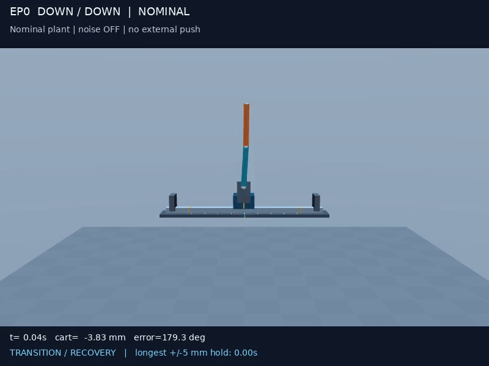](init_ep0_nominal.gif) | [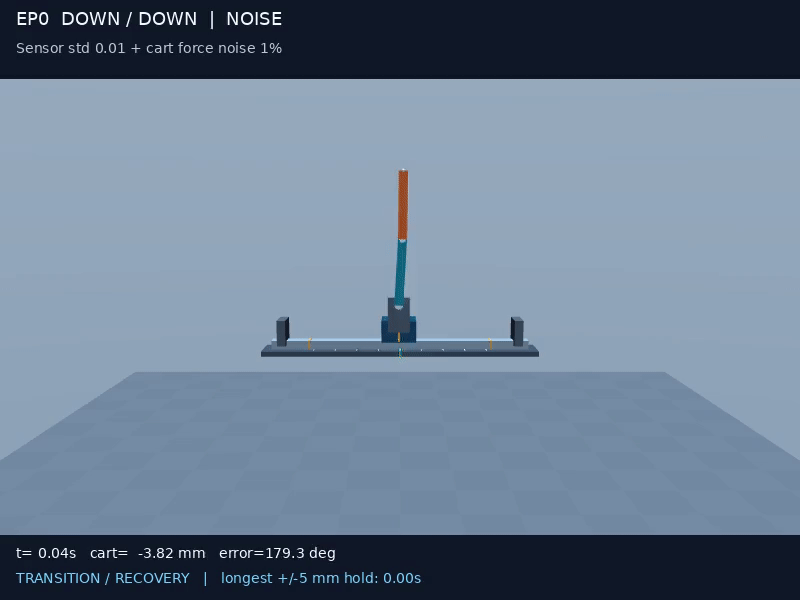](init_ep0_noise.gif) | [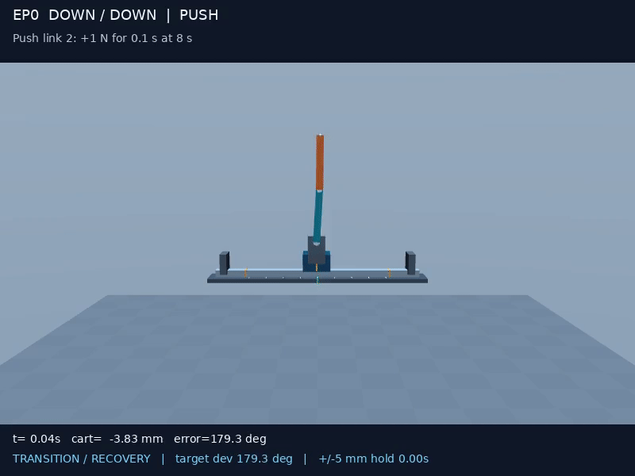](init_ep0_push.gif) |
| EP1 | [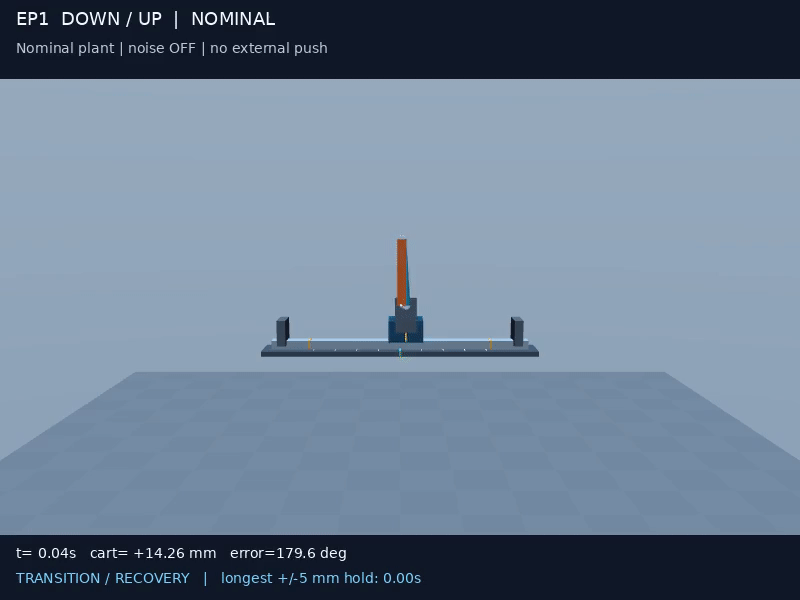](update_ep1_nominal.gif) | [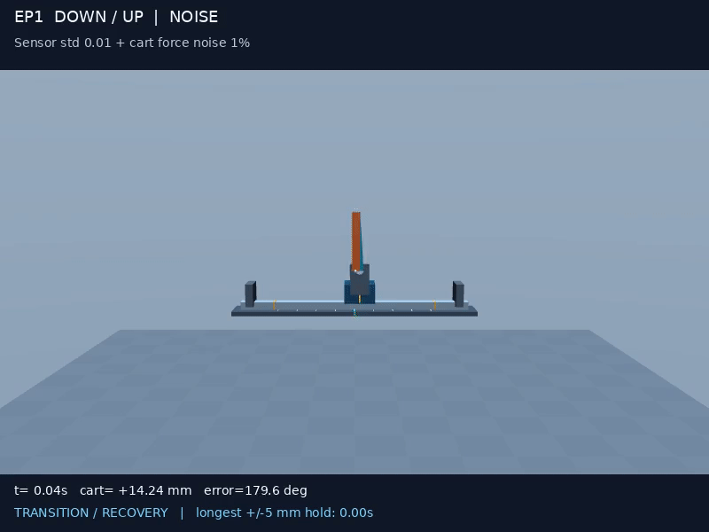](update_ep1_noise.gif) | [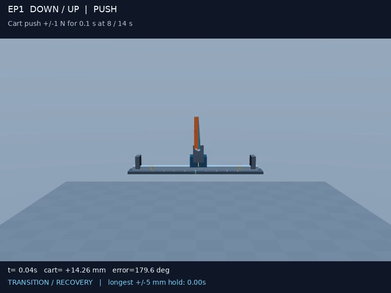](update_ep1_push.gif) |
| EP2 | [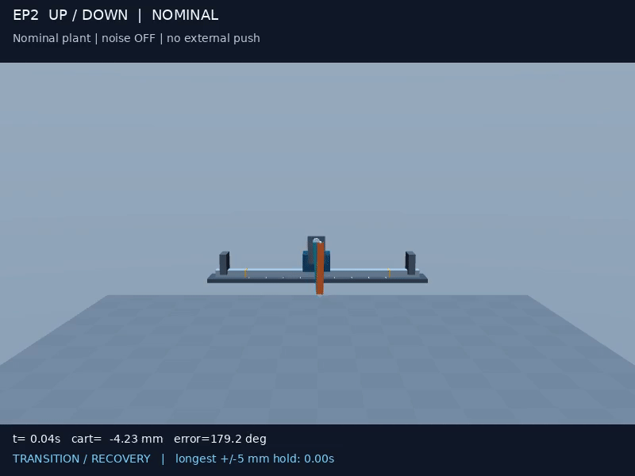](update_ep2_nominal.gif) | [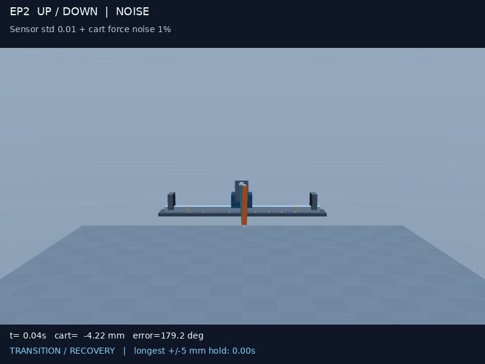](update_ep2_noise.gif) | [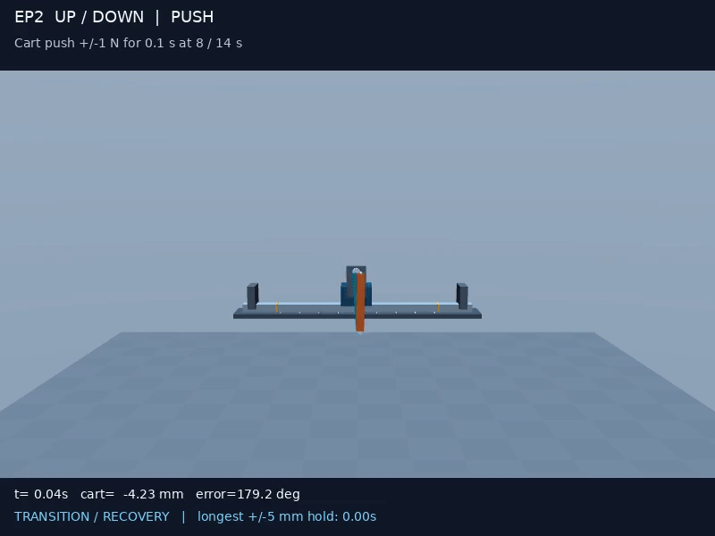](update_ep2_push.gif) |
| EP3 | [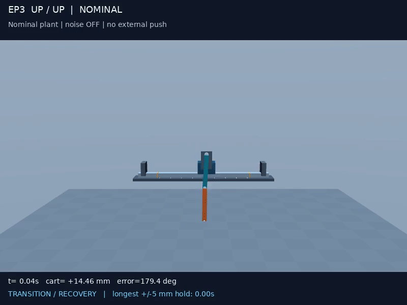](update_ep3_nominal.gif) | [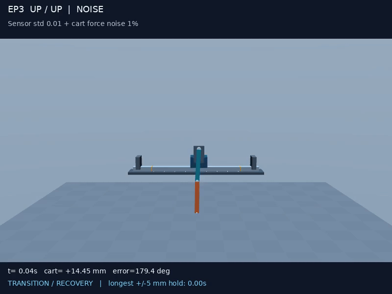](update_ep3_noise.gif) | [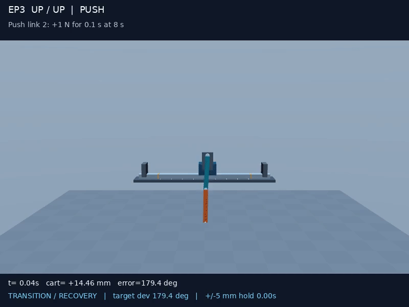](update_ep3_push.gif) |

## Protocol

- **Nominal:** measured plant, mass/damping/actuator scales all 1, sensor noise off,
  no force noise and no external push.
- **Noise:** same plant/reset, sensor noise scalar std **0.010**, cart force OU noise
  std **1% of actuator force limit**, correlation 0.25 s, clipped at ±3 std.
  The sensor scalar multiplies the runtime's channel-specific noise profile; it
  is not 0.010 m or 0.010 rad in every channel. This matches GUI medium noise
  after its amplitude was doubled.
- **Push/recovery:** nominal sensors/plant. At 8.0 s, apply a light 0.25 N force
  along world +X directly at the geometric center of link 2 for 0.10 s. The force creates a
  joint torque and knocks the bars away from their target. The GIF continues for
  12 s to show recovery. Recovery means the policy returns to target angle/speed
  and cart ±5 mm, then holds that state continuously for 1 s. The overlay reports
  the fall, maximum target-angle deviation and recovery time. Noise is off.
- **Reset:** near the opposite equilibrium, cart sampled within ±10 mm and joint
  perturbations within ±0.03 rad, zero initial velocities. Seed 42 is paired
  across the three scenarios for each target. EP0 therefore starts near upright
  instead of being initialized at its already-satisfied down/down target.
- **Push marker:** a pulsing red ring marks the link-2 contact point for 0.75 s.
  The header states target link, force direction, magnitude, start time and
  duration; the lower status line shows when the force is active and when the
  policy is recovering or has regained a stable hold.
- **Indicator:** “CENTERED + STILL” combines task target-angle/speed thresholds
  with cart ±5 mm. “Longest hold” is a demonstration statistic, not the official
  task benchmark. Any detected rail-limit event remains visibly flagged.

### One-rollout link-2 recovery measurements

| Target | Peak angle error after hit | Return and hold for 1 s | Rail limit |
|---|---:|---:|---|
| EP0 | 85.5° | 1.80 s | No |
| EP1 | 173.8° | 2.50 s | No |
| EP2 | 177.7° | 2.42 s | No |
| EP3 | 178.2° | 2.94 s | No |

These are single fixed-seed simulation demonstrations, not statistical guarantees.

## Policy provenance

EP0 uses an earlier best checkpoint, without the later centered continuation.
EP1–EP3 use best policies from the additional-10M centered continuation. All four
frozen ONNX files and hashes are in `../policies/ep*/provenance.json`.

Each clip is one complete fixed-seed rollout; no failed segment is removed and no
seed search is performed. These videos illustrate behavior and do not establish
success rates, robustness across all randomizations or physical hardware readiness.

## Reproduce

From repository root, install the video extra and FFmpeg/EGL support:

```bash
python -m pip install -e '.[video]'
MUJOCO_GL=egl python scripts/render_ep_videos.py
python scripts/create_ep_gifs.py --remove-source-mp4 --remove-jpg-json
```

The renderer creates temporary MP4s, JPG thumbnails and JSON traces. The final command
converts and verifies the GIFs, then removes those temporary files and sidecars. Policy
hashes and source provenance remain in `../policies/ep*/provenance.json`.
